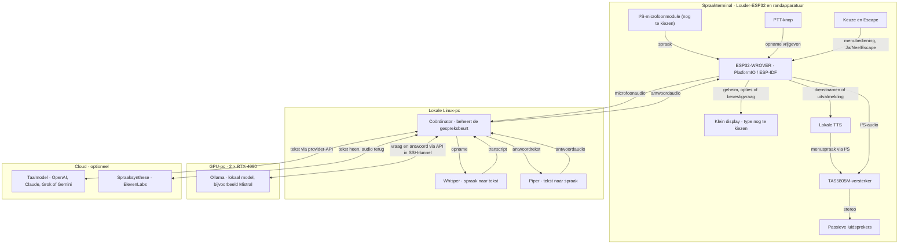

# Architectuur en eerste besluiten

## Vastgelegd

| Besluit | Reden |
| --- | --- |
| Bestaande Louder-ESP32-WROVER behouden | Dit is de aanwezige hardware. |
| PlatformIO met ESP-IDF | Sluit aan bij de projecten en voorkeur van de gebruiker. |
| Eigen firmware bij voorkeur in C | Kleine expliciete modules en zichtbare kosten. |
| Zelfstandige Linux-coördinator | Geen Home Assistant als fundament. |
| STT, LLM en TTS voor assistentantwoorden op de backend | Zware verwerking blijft verwisselbaar. Voor lokale menuspraak geldt voorlopig B-010. |
| GPU-API aanvankelijk via SSH-tunnel | De GPU-pc is momenteel via SSH bereikbaar. |
| Ontwerp eerst, kleine hardwareproeven daarna | Voorkomt grote implementaties op onbewezen aannamen. |

## Systeemdiagram

Ontwerp voor één gespreksbeurt. De kaders geven aan waar een onderdeel draait;
de labels op de pijlen vertellen wat het ontvangt of teruggeeft.

Het diagram toont de assistentroute na dienstkeuze. Intercom en muziek hebben hun eigen bestemming; discovery en selectie staan nog los van het gekozen transport.

**Leesvoorbeeld voor studenten:** volg één vraag vanaf de microfoon. Whisper levert
het transcript; de coördinator vraagt Ollama om een antwoord en geeft de antwoordtekst
aan Piper. Volg de audio terug tot de luidsprekers. Bij deze route verlaat niets het
eigen systeem. Een cloudmodel of cloudstem vervangt alleen de gekozen stap. Het
transportprotocol tussen ESP32 en Linux staat nog open; zie de [protocolafweging en vergelijkingsproef](plan-protocolkeuze.md).

De ESP32 beheert capture, playback, mute en lokale bediening. Eén audio-eigenaar
beheert de samenhang tussen I²S en versterkertoestand. Pas taken toevoegen wanneer
blokkeren of timing dat nodig maakt. Linux beheert sessies, resampling, modellen,
credentials en annulering. SSH is beheer/tunnel, niet het inferenceprotocol.

Provider- en model-ID's zijn Linux-configuratie. STT/LLM/TTS hebben verschillende
rollen en capabilities; ontwerp hun concrete interfaces zodra de eerste werkende
spraakpipeline die nodig heeft. Geen generiek pluginframework vooraf.

Voor de opbouw van de assistent zelf (prompt, guardrails, geheugen, tools) is
[Harness²](plan-agent-harness.md) de inspiratie ([B-014](decisions.md#b-014-assistent-als-expliciete-harness), voorstel).

## Labscenario

Voorlopig ontwerp volgens [B-010](decisions.md#b-010-lokale-dienstkeuze-en-push-to-talk-in-het-lab). De gebruiker loopt met de microfoon door het lab. De ESP32 ontdekt de gebruikersdiensten; welke modellen achter een assistent draaien is een keuze van diens backend. Linux kan een lijst van beschikbare instanties leveren of de ESP32 kan hun aankondigingen zelf ontvangen. Beide passen bij deze taakverdeling; geen van beide is al gekozen.

1. De gebruiker kiest de standaardassistent, houdt PTT ingedrukt en vraagt: ‘Waar liggen de scope-probes?’ Na loslaten stopt de opname. De backend raadpleegt de inventaris: ‘Kast 1, lade B. Volgens de registratie liggen er vier.’
2. Bij de kast drukt de gebruiker opnieuw: ‘Er lagen maar twee probes.’ De backend koppelt die observatie aan dezelfde lade en hetzelfde artikel. **Twee aangetroffen is geen uitboeking van twee.** Is onduidelijk of het aantal vóór of ná het pakken geldt, vraag dat na vóór een wijziging. Na wegvallend wifi mag dezelfde correctie niet blind opnieuw worden uitgevoerd.
3. Verdwijnt de standaardassistent, dan spreekt de ESP32 de actuele alternatieven uit: bijvoorbeeld ‘Assistent groep 2’, ‘Intercom’ of ‘Muziek’. Pas na keuze gaat een nieuwe beurt naar die bestemming. Zonder bereikbare dienst geeft het board lokaal een melding; het bewaart geen opname om later naar een andere bestemming te sturen.

**Voorgestelde acceptatieproeven:** controleer bij boot, tijdens het menu en na loslaten dat er geen nieuwe microfoonsamples worden opgenomen of verstuurd (ook geen pre-roll). Schakel alleen de primaire assistent uit: lokale TTS moet nog werken en de gebruiker moet een beschikbare testversie kunnen kiezen. Controleer aan de ontvangende kant dat uitsluitend de gekozen instantie de volgende beurt krijgt. Test apart met het netwerk helemaal weg: alleen de lokale melding wordt dan verwacht. Dit zijn ontwerpcriteria, geen gemeten resultaten.

### Gesproken bediening

De [drie knoprollen](decisions.md#b-011-drie-knoppen-voor-bediening-zonder-scherm) staan vast. **Voorstel voor de eerste gebruikersproef:** één korte druk op Keuze geeft altijd antwoord op ‘waar ben ik?’, bijvoorbeeld: ‘Actief: labassistent, standaard. Menu: diensten. Optie twee: intercom.’ Dit verandert de selectie niet. Laat een lange druk op het hoofdniveau het keuzemenu openen. Daar leest de ESP32 de beschikbare opties achtereenvolgens voor, met een pauze na iedere naam; lang drukken bevestigt de laatst volledig uitgesproken optie. Tijdens een nieuwe naam nog geen bevestiging accepteren. Meld na bevestiging welke dienst actief is.

Vergelijk dit met drie korte drukken voor optie drie. Direct nummeren kan sneller zijn, maar één druk kan dan pas als status worden herkend nadat de tijd voor een tweede druk is verstreken. In beide ontwerpen mag een wijziging in de dienstenlijst een al voorgelezen optie niet stilzwijgend vervangen door een andere dienst.

**Praktijkproef (nog niet uitgevoerd):** laat iemand zonder scherm vanuit een onbekend submenu de actieve dienst opvragen en met Escape naar ‘Hoofdmenu’ teruggaan. Druk daar nogmaals op Escape: dezelfde hoofdtoestand moet hoorbaar blijven zonder dienstwissel of opname. Herhaal zonder backend en met een dienst die tussen voorlezen en bevestigen verdwijnt.

### Display en bevestiging

De eis staat vast in [B-013](decisions.md#b-013-display-voor-discrete-informatie-keuze-en-bevestiging);
de uitwerking hieronder is een **voorstel** om te toetsen. Het display vult de
spraak aan, het vervangt haar niet: de [gesproken bediening](#gesproken-bediening)
moet ook zonder kijken werken.

| Functie | Voorbeeld | Waarom niet alleen via audio? |
| --- | --- | --- |
| Discreet tonen | Wachtwoord of toegangscode voor een labsysteem | Een luidspreker is openbaar; omstanders horen mee. |
| Kiezen | Vier opties, bijvoorbeeld een dienst of een bestemming | Lezen gaat sneller dan vier opties aanhoren. |
| Bevestigen | "2 voicemails verwijderen (A, B)? Ja / Nee / Escape" | Spraakherkenning kan "nee" als "ja" verstaan; een onomkeerbare actie vraagt een fysieke handeling. |

**Bevestigen, voorgestelde regels:**

1. Een bevestigvraag hoort bij precies één opdracht. Het verzoek bevat de
   `command_id` en de selectie uit [B-012](decisions.md#b-012-alle-berichten-verwijst-naar-een-vaste-selectie);
   het antwoord van het board noemt dezelfde `command_id`. Een knopdruk zonder
   openstaande vraag doet niets.
2. Alleen een expliciete **Ja** leidt tot uitvoering. Nee, Escape, een timeout,
   een herstart of verbroken verbinding betekenen: niet uitvoeren.
3. Ja is nooit voorgeselecteerd. Een knop die al ingedrukt was toen de vraag
   verscheen, telt pas na loslaten. Mogelijk telt Ja pas na een korte minimale
   leestijd.
4. De tekst op het scherm komt van de dienst die de actie uitvoert, gemaakt uit
   de vastgelegde selectie, met aantallen. Het taalmodel formuleert hem niet:
   wat de gebruiker bevestigt, moet zijn wat wordt uitgevoerd.
5. Welke acties een bevestiging vereisen, staat in een vaste lijst in de
   backendcode (guardrail, zie [B-014](decisions.md#b-014-assistent-als-expliciete-harness)).
   Spraak kan een bevestiging aanvragen, maar niet vervangen.
6. Na uitvoering meldt Jarvis de werkelijke uitkomst, zoals beschreven in het
   [contextplan](plan-context-en-initiatief.md#waar-ligt-de-tijdgrens-van-alle).

**Geheimen tonen, voorgestelde regels:** niet uitspreken via TTS, niet loggen
op de seriële console, niet in flash opslaan, scherm wissen na een timeout,
Escape of het einde van de beurt. Alleen over een versleutelde verbinding.
Bij boot en na een fout is het scherm leeg.

**Eigenaarschap op de ESP32:** één lokale interfacemodule beheert display en
knoppen, zoals één audio-eigenaar I²S en versterker beheert. De backend vraagt
iets te tonen; de ESP32 bepaalt wat de knoppen op dat moment betekenen.

**Hardware:** de H9-print heeft een 30-pins OLED-FPC-aansluiting op SPI. De
knoppen hebben vrije GPIO's nodig; zie het
[hardwaredossier](../hardware/louder_esp32/README.md#display-en-knoppen).

**Open, nog af te stemmen:**

- Hoe passen Ja, Nee en Escape op de knoppen van B-011? Vier knoppen (Spreek,
  Ja/Keuze, Nee, Escape), of Keuze die de focus verplaatst met een lange druk
  als bevestiging?
- Welk display: de SH1106-OLED (128×64) die Sonocotta gebruikt, of iets anders?
  Hoe discreet is discreet: kijkhoek, helderheid, automatisch uit?
- Kiezen uit vier opties: één knop per optie, of bladeren en bevestigen?
- Mag het scherm passief status tonen (actieve dienst, verbinding), of alleen
  op verzoek?

**Te toetsen:** stuur een bevestigvraag, verbreek de verbinding en druk Ja; de
actie mag niet plaatsvinden. Houd Ja ingedrukt terwijl de vraag verschijnt; die
druk mag niet tellen. Stuur twee vragen kort na elkaar; een druk mag alleen de
zichtbare vraag beantwoorden. Controleer na Escape en na een timeout dat een
getoond wachtwoord van het scherm en uit het RAM-buffer is gewist.

## Audiohypothese: eerst bewijzen

Voor de onderzochte H6+-uitvoering delen microfoon en versterker BCLK/WS. De
voorgestelde basis is 48 kHz, Philips-I²S, twee 32-bit slots en één geselecteerde
microfoon. Een gemeenschappelijk TX/RX-klokdomein voorkomt omschakelen tussen
opname en weergave. Controleer dit tegen de werkelijke revisie en microfoonmodule.

Later kan PCM16 mono op 48 kHz naar Linux: 96.000 bytes/s zonder transportoverhead.
Linux filtert/resamplet naar 16 kHz voor Whisper en levert playback op 48 kHz.
Het netwerkformaat is niet hetzelfde als de DMA-slotindeling.

De eerste interactie is push-to-talk en functioneel halfduplex. Wake word, VAD,
AEC, twee-microfoonverwerking en vrije barge-in zijn vervolgstappen met eigen
resource- en herkenningstests. Jarvis-wake-wordondersteuning op dit WROVER-board
en een fysieke TAS5805M-SDOUT-referentieroute naar de MCU zijn niet bevestigd.

## Eerste firmwaremijlpaal

Eerst de open punten in het [hardwaredossier](../hardware/louder_esp32/README.md)
afhandelen. Daarna één project: `tests/bringup/audio/esp_audio/`.

1. Kies en pin een PlatformIO-platform voor klassieke ESP32 en een onderbouwde
   boardconfiguratie. Leg flashgrootte, PSRAM, console en drivercompatibiliteit vast.
2. Bouw een minimale `app_main` en controleer bootdiagnostiek via de console.
3. Initialiseer I²S en versterker in de vereiste volgorde, met mute als starttoestand.
4. Speel één kort bekend signaal op begrensd volume en keer terug naar stilte.
5. Controleer fouten en herstart voordat microfooncapture wordt toegevoegd.

Deze mijlpaal heeft geen netwerk, modelkoppeling of assistant-FSM nodig.

| Contract | Bescherming / verificatie |
| --- | --- |
| Geen ongewenste playback bij init of fout | Mute vóór activering; geen unmute na mislukte init; koude start/reset testen. |
| Geen DSP-configuratie zonder vereiste klokken | Initialisatievolgorde uit driver/TI-documentatie; log stappen en uitkomst. |
| Buffers blijven geldig tijdens I/O | Eén eigenaar; I/O afronden vóór reset/deinit; vaste buffers en eindige timeouts. |
| Ontbrekende versterker veroorzaakt geen rebootlus | Fout loggen, playback niet starten, herstelpad expliciet houden. |
| Build reproduceerbaar | Vastgezette versies en exacte buildcommando's in de project-README. |

Acceptatie: build geslaagd, gecontroleerde korte playback, terugkeer naar stilte,
herhaalbare herstart en foutgedrag zonder ongecontroleerd geluid. Hardwaregedrag
is pas geverifieerd na een geregistreerde proef, niet na alleen een build.

## Wat volgt

Eén microfoon valideren; daarna audio naar Linux en push-to-talk; vervolgens lokale
Whisper/TTS, een GPU-model en cloudadapters. Display en knoppen krijgen een eigen
hardwareproef (`tests/bringup/display/`), los van audio. Kies het netwerkprotocol vóór de eerste
stream, met expliciete framing, formaat, grenzen, deadlines en sessie/beurt-ID's.
Na annulering mogen oude chunks niet opnieuw hoorbaar worden.

Nog nodig: boardfoto's/revisie, microfoonmodule, voeding/luidsprekers, lokale
Linux-specificaties en GPU-hostinformatie. Leg transport-, model- en latencykeuzes
vast wanneer die informatie en eerste metingen beschikbaar zijn.
